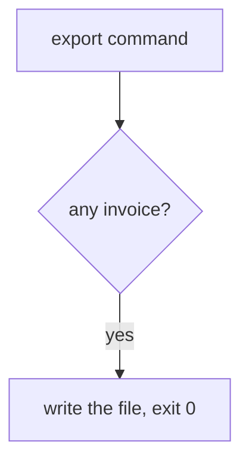

# capabilities/

One file per capability: how it works today, with the evals that prove each rule. A spec that changes
a capability's behavior says so in its own `## Capability changes` section, and the merge applies it.
This is the only place the format and the rules are written; everything else points here.

A capability gets its file the first time a spec changes it, with `ADDED`; nothing is back-filled. A
repo with no capability file needs no general diagram (see "The first capability").

## A capability file

`capabilities/<capability>.md`. The title, then the Mermaid diagram of the flow, then the purpose and
the requirements.

The text is written in the language of the repo's documents. The fixed words stay in English: the
headings `## Purpose`, `## Requirements`, `### Requirement:` and `#### Scenario:`, the words `SHALL`,
`WHEN`, `THEN` and `AND`, the line `Evals:` and the kinds of a spec's section (below).

````markdown
# Invoice export



## Purpose
One or two sentences.

## Requirements

### Requirement: Exports every invoice of the month
`export` SHALL write one row per invoice of the month and exit 0.
Evals: S001-C1

#### Scenario: A month with invoices
- WHEN `export 2026-01` runs on a month with two invoices
- THEN the file has two rows and the exit code is 0
````

- The file has exactly one `mermaid` block and it is the first thing after the `#` title. It opens with
  `flowchart`, `graph`, `stateDiagram-v2` or `sequenceDiagram`, closes its fence, and has balanced
  brackets, braces, parentheses and quotes on every line.
- A requirement is identified by its title, compared exactly after trimming spaces. It states one
  behavior with SHALL, in the code as it is today, and nothing that no eval proves.
- `Evals:` is a line of eval ids in each requirement, at least one. An id has the form `S<NNN>-C<n>`
  (spec number and criterion number: `S001-C1, S014-C3`). Each id has to be printed by `evals/run.sh` as
  a line that starts with `PASS <id>` for the merge to go through.
- Each requirement has at least one `#### Scenario:` with `WHEN` / `THEN` / `AND` lines.
- The general diagram of how the parts connect is the one at the top of `ARCHITECTURE.md`: a `mermaid`
  block before its first `##` title. It must have a node whose text is each capability's file name
  (without `.md`).

## The first capability

A repo that was just born has no capability file and its `ARCHITECTURE.md` has no diagram: the check
needs no general diagram until there is a capability to name. The first spec that adds a capability
brings, in the same branch, the general diagram at the top of `ARCHITECTURE.md` with a node for it.
From the first capability file on, `scripts/check-capability-diagrams.sh` requires the general diagram.

## The `## Capability changes` section of a spec

After the acceptance criteria. Headings are one level lower than in the file, so several capabilities
fit in one document; to copy a block into the file, remove one `#` from each heading.

````markdown
## Capability changes

### invoice-export · DIAGRAM

```mermaid
flowchart TD
  ...the whole new diagram...
```

### invoice-export · MODIFIED

#### Requirement: Exports every invoice of the month
...the whole new requirement...
Evals: S001-C1, S014-C3

##### Scenario: ...

### tax-report · ADDED
Purpose: only when the capability's file does not exist yet.

#### Requirement: ...
````

Each block is `### <capability> · <KIND>`, with KIND one of `DIAGRAM`, `RENAMED`, `REMOVED`,
`MODIFIED`, `ADDED`.

- `DIAGRAM`: the whole new diagram in a `mermaid` block, or the single line `Diagram: unchanged`.
- `ADDED`, `MODIFIED`: whole requirement blocks (`#### Requirement:` with its `Evals:` and its
  `##### Scenario:` blocks).
- `REMOVED`: one `#### Requirement: <title>` line per requirement.
- `RENAMED`: `FROM: <old>` and `TO: <new>` lines.

## The applier and its rules

`scripts/apply-capability-changes.sh <spec>` applies the section onto `capabilities/`. Exit 0 applied or
nothing to apply, 1 stopped (prints capability, requirement and rule), 2 misused.

1. It checks everything first and then writes. If anything fails, no file is touched.
2. Per capability the order is RENAMED, REMOVED, MODIFIED, ADDED.
3. MODIFIED: the requirement has to exist; the new block replaces the old one whole. If the new block
   lacks a scenario the old one had, it stops, unless the block names it in a line
   `Drops scenario: <name>`.
4. ADDED: an existing requirement with the same title and the same text is skipped (so applying twice
   equals applying once); with other text it stops.
5. REMOVED: the requirement has to exist, or it stops.
6. RENAMED: `FROM` has to exist and `TO` must not.
7. A capability with no file accepts only ADDED, and its block carries `Purpose:`.
8. Each added or modified requirement has an `Evals:` line with an id and at least one scenario.
9. The same requirement in two sections of the same capability stops. The one exception is the target of
   a rename modified under its new name in the same capability (`RENAMED` `FROM: A` `TO: B` plus
   `MODIFIED` of `B`): it is not a conflict, and rule 2 applies the rename first.
10. A spec without the section does nothing and exits 0.
11. Every capability the section touches has its `DIAGRAM` block. A `mermaid` block replaces the one
    that opens the file; `Diagram: unchanged` leaves it; a new capability always brings a `mermaid`
    block.

## What the merge does

Gate 2 is `scripts/merge-if-green.sh <branch>`, run by a person on `main`, never a bare `git merge`.
Usage: `scripts/merge-if-green.sh <branch> [-m "message"] [--require-render] [-- <arguments for evals/run.sh>]`.

The branch has to declare itself finished in a file: `status: implementada` in the spec it archived under
`specs/done/`, or the trailer `Listo-para-merge: si` in its last commit. Without either, nothing is merged.

After merging and before the suite:

1. If the declared spec has the section, the script runs the applier and adds the changes to the merge
   commit (`--amend`). If the applier stops, the merge is undone.
2. In every merge, with or without the section: `scripts/check-capability-diagrams.sh` (the form rules
   above, and a node for each capability in the general diagram) and `scripts/render-mermaid.sh` (every
   diagram drawn for real by `@mermaid-js/mermaid-cli@11.16.0`). If either stops, the merge is undone.
3. The suite, `evals/run.sh`, over the result of the merge. The merge is green with exit 0, no line
   that starts with `FAIL` and a last line that ends in `· 0 fail` or `· 0 fallan`. Otherwise it is undone.
4. With the suite green, `scripts/check-capability-evals.sh <suite output>`: every requirement has an
   `Evals:` line and every id has its `PASS` line. If not, it is red and the merge is undone.

With no flags, the drawing never uses the network: if `npx`, the pinned package in the npm cache or
Chromium is missing, `scripts/render-mermaid.sh` prints one line that starts with `render-mermaid: SKIPPED`
(what is missing, how many diagrams were not drawn and the command that brings it) and exits 0, and the
merge goes on. With `--require-render` the drawing is a condition: when the npm cache is cold the script
fetches the pinned package once, with the same version, and tries again; if it cannot fetch it, or `npx` or
Chromium is missing, the merge stops and is undone. A diagram that does not draw, when the drawing tool is
there, always stops it.

What comes after `--` goes to `evals/run.sh` as it is. `--spec` after `--` exits 2: the merge runs the
whole suite, never a part of it.
